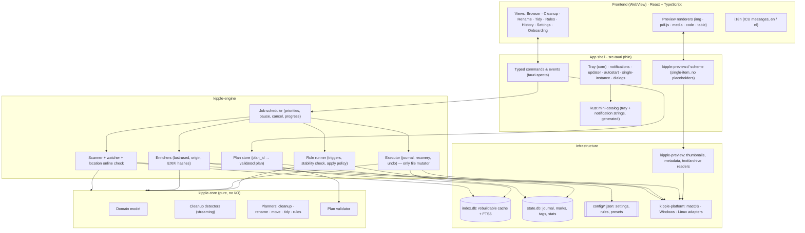
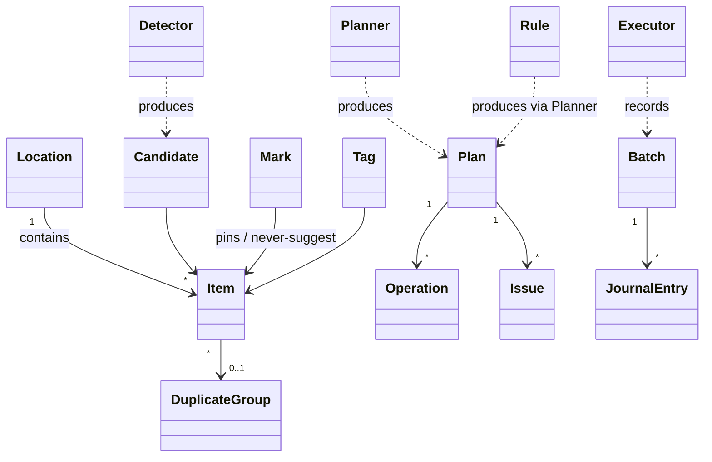
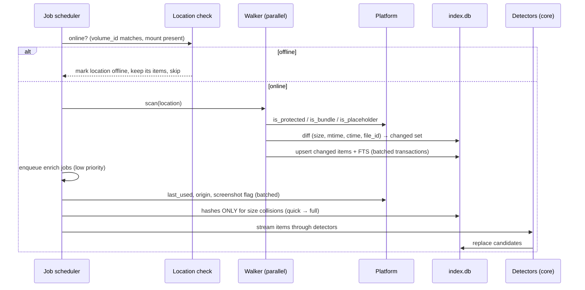
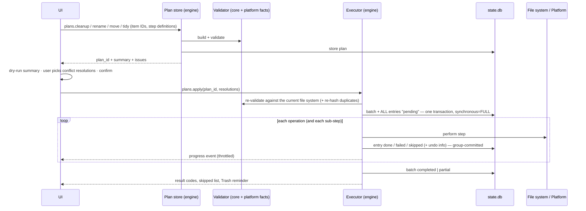

# Kipple: Architecture

Status: **draft v0.2**. It covers the MVP and leaves room for v1. This revision adds the findings of an independent architecture review (data-loss scenarios, trust boundary, missing MVP homes).
Functional scope is in [FUNCTIONAL_PLAN.md](FUNCTIONAL_PLAN.md), domain terms in [CONTEXT.md](CONTEXT.md), and decisions in [adr/](adr/).

---

## 1. Architectural drivers

These are the requirements from the functional plan that shape the architecture most.

| # | Driver | Consequence |
|---|---|---|
| D1 | **Safe by default**: undo everything, recover from crashes, never delete permanently without consent | Every change goes through one **Plan → Review → Apply** pipeline with a durable write-ahead **journal** ([ADR-0002](adr/0002-plan-review-apply.md)) |
| D2 | **Linux, macOS and Windows from one codebase**, unsigned, no server | Tauri 2 + Rust core ([ADR-0001](adr/0001-tauri-rust-core.md)). OS code sits behind **platform ports** ([ADR-0005](adr/0005-platform-ports.md)) |
| D3 | **Performance**: 1M files, first scan of 100k files < 60 s, UI response < 100 ms, idle < 200 MB | Native parallel scanner, SQLite + FTS5 index, lazy hashing, streaming detectors, virtualised UI, no webview while in the tray |
| D4 | **Privacy**: nothing leaves the machine | No network code except the updater, no telemetry, salted redaction of logs |
| D5 | **EN + NL, translation-ready** | The backend emits **codes, not text**; one catalog in `locales/` ([ADR-0004](adr/0004-i18n-codes-not-text.md)) |
| D6 | **Rules run automatically only when enabled**, with bulk limits | Rules produce Plans, and an apply policy enforces the limits. Rules never delete permanently |
| D7 | **Testable with TDD** | A pure domain core, port fakes, and a headless CLI harness with fault injection |
| D8 | **Previews of untrusted files** | **The backend is the trust boundary** ([ADR-0007](adr/0007-backend-trust-boundary.md)). It serves previews through a custom scheme that only returns the item being previewed |

---

## 2. System overview



**Layering rule:** dependencies only point inward. `kipple-core` depends on nothing. The engine depends on core and on port *traits*. Adapters implement those traits. The Tauri shell wires everything together and holds no business logic.

---

## 3. Technology choices

| Concern | Choice | Notes |
|---|---|---|
| App framework | **Tauri 2** | Bundles dmg/nsis/msi/deb/rpm/AppImage; tray is built into the core; official plugins for updater, notification, autostart, single-instance, dialog and opener |
| Backend language | **Rust** (stable), Cargo workspace | |
| Frontend | **React + TypeScript + Vite** | |
| UI components | Radix UI primitives + Tailwind CSS | Accessible by default |
| Frontend data | TanStack Query (server state), Zustand (UI state), TanStack Virtual (long lists) | |
| IPC typing | **tauri-specta** (v2) | Generates TypeScript bindings from Rust. If the RC is unstable, the fallback is `specta` + a hand-rolled export script |
| i18n | **FormatJS / react-intl** (ICU MessageFormat) in the UI; **ICU4X** (`icu_plurals`, `icu_decimal`) for the small Rust-side catalog | One source: `locales/` |
| OS locale | `sys-locale` (read in Rust, passed to the UI) | `navigator.language` in WKWebView may not reflect the OS language |
| Database | **SQLite** via `rusqlite` (bundled), WAL mode, **FTS5 trigram** for name search | |
| Async / parallelism | `tokio` (orchestration, I/O), `rayon` (CPU-bound hashing/decoding) | |
| File walking | `ignore` crate's parallel walker **with `standard_filters(false)`** | Otherwise it silently skips hidden and gitignored files. A Windows fast path may be needed (§7.1, S4) |
| File watching | `notify` + `notify-debouncer-full` | |
| Hashing | `blake3` | |
| Type sniffing | `infer` | Reads the first bytes only |
| EXIF / images | `kamadak-exif`, `image`; `image_hasher` for perceptual hashes (v1) | |
| Trash | `trash` crate (Windows, Linux) + native `NSFileManager` on macOS (§7.2) | |
| Archives (v1) | `zip`, `tar`, `sevenz-rust` | |
| PDF / code / media preview | pdf.js (**pinned ≥ 4.2.67**, CVE-2024-4367), CodeMirror 6 (read-only), HTML5 media | |
| Logging | `tracing` + rolling file appender + salted redaction layer + panic hook | |
| Testing | `cargo test`, `proptest`, `tempfile`, `criterion`; Vitest + Testing Library; Playwright | |

All choices are GPL-3.0-compatible. `cargo-deny` and an npm licence check enforce this in CI.

---

## 4. Repository layout

```
kipple/
├─ Cargo.toml                  # workspace
├─ crates/
│  ├─ kipple-core/             # pure domain: model, detectors, planners, validator, rename engine
│  ├─ kipple-index/            # SQLite schema, migrations, queries (index.db + state.db)
│  ├─ kipple-engine/           # jobs, scanner, watcher, enrichers, plan store, executor, rule runner, scheduler
│  ├─ kipple-platform/         # port traits + macos/, windows/, linux/ adapters + fakes for tests
│  ├─ kipple-preview/          # thumbnails, metadata extraction, text/archive readers
│  ├─ kipple-i18n-rs/          # build-time generated Rust catalog for tray/notification strings
│  └─ kipple-cli/              # headless harness: scan/plan/apply/bench/fault-inject
├─ app/
│  ├─ src-tauri/               # shell: commands, preview scheme, tray, updater, windows, capabilities
│  └─ src/                     # React UI
│     ├─ features/             # browser/, cleanup/, rename/, tidy/, rules/, history/, settings/, onboarding/
│     ├─ preview/              # renderers per file kind
│     ├─ bindings/             # generated by tauri-specta (do not edit)
│     └─ i18n/
├─ locales/                    # en/*.json, nl/*.json: the single source for all user-visible text
├─ docs/                       # plan, architecture, ADRs, install guide
└─ .github/workflows/          # ci.yml (test matrix), release.yml (build, checksums, attestations)
```

---

## 5. Domain model (summary)

Full definitions are in [CONTEXT.md](CONTEXT.md).



- **Location**: a managed root (user folder, custom folder, external or network drive). It has an **online state** (§7.1) and a **volume capability** record: trash support, case sensitivity, stable file IDs, kind.
- **Item**: a file, folder, symlink or bundle. It has exactly one **type category** (Images, Installers…) plus any number of **facets**: status (active/stale/candidate/pinned), origin, tags and cleanup reasons. Plan §2's "several categories" are implemented as type category + facets.
- **Detector** → **Candidate**: a reason *code* + parameters, confidence, reclaimable bytes.
- **Plan**: Operations + Issues. It is **created, stored and validated by the backend** and referenced by `plan_id` ([ADR-0007](adr/0007-backend-trust-boundary.md)).
- **Operation**: `Move`, `Rename`, `Trash`, `CreateDir`, `RemoveEmptyDir`, `Extract`*, `Compress`*, `Tag`*, `Hold`* (*v1).
- **Batch / JournalEntry**: the applied Plan, for history, undo and recovery.
- **Rule**: data that yields Plans. **Mark** and **Tag**: user data that survives rescans and moves.

---

## 6. Data storage

Storage is split by how precious the data is ([ADR-0003](adr/0003-storage-split.md)):

| Store | Contents | Durability | Location |
|---|---|---|---|
| `index.db` | Items, metadata, hashes, candidates, duplicate groups, FTS5 name index | **Disposable.** Rebuilt by rescan; a schema change may simply rebuild it. WAL, `synchronous=NORMAL` | app data dir |
| `state.db` | Plans (short-lived), journal, marks, **tags**, stats, location size history, rule run history | **Precious.** WAL with **`synchronous=FULL`** (so the write-ahead commit survives power loss), forward-only migrations, backup before each migration | app data dir |
| `config/*.json` | Settings, rules, rename and tidy presets | **Portable.** Versioned schema, export/import, may live in a user-synced folder | app config dir |
| Thumbnail cache | Generated thumbnails | Disposable; LRU with a size cap | app cache dir |
| Logs | Rolling log files | Disposable, redacted | app log dir |

**Settings → Remove all Kipple data** (MVP) deletes all of the above. This is needed because the `.dmg`, AppImage and portable `.exe` have no uninstaller.

### 6.1 index.db (key tables)

```sql
location(id, path, kind, enabled, volume_id, online, last_seen_online_at,
         cap_trash, cap_case_sensitive, cap_stable_ids, in_sync_root, added_at)
item(id, location_id, path, parent_path, name, ext, kind,           -- file | dir | symlink | bundle
     size, created_at, modified_at, changed_at,                     -- changed_at = ctime / NTFS ChangeTime
     file_id, volume_id,
     mime, type_category, is_hidden, is_placeholder, is_screenshot,
     last_used_at, last_used_source,                                -- spotlight | recent | xbel | atime | app
     origin_url, quick_hash, full_hash, hashed_at, phash, meta_json,
     scanned_at, enriched_at)
item_name_fts USING fts5(name, tokenize='trigram')                  -- substring search < 100 ms at 1M rows
candidate(item_id, detector, confidence, reason_code, reason_params_json,
          reclaim_bytes, group_id, computed_at)
duplicate_group(id, size, full_hash, suggested_keep_item_id)
```

Indexes cover `(location_id, parent_path)`, `(type_category)`, `(size)`, `(full_hash)`, `(last_used_at)` and `(modified_at)`. Lists use keyset pagination.

### 6.2 state.db (key tables)

```sql
plan(id, kind, created_at, expires_at, ops_json, issues_json, validated_at, status)
batch(id, plan_id, source_kind, source_ref, status, created_at, started_at, finished_at,
      op_count, bytes, summary_code, summary_params_json)
      -- source_kind: manual | cleanup | rename | move | tidy | rule | undo | retry
      -- status: running | completed | partial | interrupted | rolled_back
journal_entry(id, batch_id, seq, op_kind, step,          -- step: for multi-step ops (cross-volume move, case rename)
              src_path, dst_path, tmp_path, status,
              identity_json,          -- volume_id + file_id (+ path)
              content_json,           -- size + mtime + ctime (+ hash when relevant)
              undo_json,              -- e.g. the trash location of the item
              error_code, error_params_json, updated_at)
mark(id, kind, scope, path, file_id, volume_id, detector_id, rule_id, created_at)
tag(id, name, color) ; item_tag(tag_id, path, file_id, volume_id)
stat_daily(day, bytes_reclaimed, files_trashed, files_moved, files_renamed)
location_size_daily(day, location_id, bytes, files)      -- clutter trend (v1)
```

**Identity across moves:** marks, tags and journal entries reference items by `(volume_id, file_id)` where the OS provides it, with the path as fallback. So a pinned or tagged file keeps that after you move it.

---

## 7. Core flows

### 7.1 Scan & index



1. **Online check first.** Each location stores its `volume_id`. If the volume is missing or different (an unmounted Linux mountpoint is an empty dir, a disconnected NAS, an ejected USB drive), the location is marked **offline**. Its items are kept and its candidates hidden. **Missing files on an offline location are never treated as deleted**, and an empty mountpoint is never an "empty folder" candidate.
2. **Walk** in parallel, with `standard_filters(false)`. Exclusions and protected paths are skipped.
   - **Bundles** (`.app`, `.photoslibrary`, …) and **VCS dirs** (`.git`, `.svn`, `.hg`) are opaque items and are never descended into.
   - **Windows:** enumerate each folder with **`GetFileInformationByHandleEx(FileIdBothDirectoryInfo)`**. It returns file ID, ChangeTime, size and mtime in one bulk call per folder, and in spike S4 it was the fastest strategy (1M files in 3.4 s, versus 9.4 s when opening every file). Fall back to std enumeration + a per-file handle when the call isn't supported (some network shares). On FAT/ExFAT the path is the identity. ✅ Decided in S4 ([report](../spikes/s4-scan-perf/README.md)).
3. **Diff per directory** on `(size, mtime, ctime, file_id)`. When the walker enters a folder, it loads only that folder's index rows (`WHERE parent_path = ?`) and compares them. **Never load the whole location into memory:** a whole-tree map costs about 320–400 MB at 1M files (S4). Adding ctime catches tools that preserve mtime but change content (`rsync -t`, archive extraction). When an item changes, its hashes are cleared. NTFS may report directory-entry metadata a little late, which is covered by the Validator re-stat-ing every item at apply time.
4. **Classify** by extension. Use `infer` for unknown or ambiguous extensions. **Placeholders are only `stat`-ed, never opened.**
5. **Enrich** in the background (low priority, batched): last-used, download origin, EXIF/dimensions, and the **screenshot flag**. Screenshot file names are localised ("Schermafbeelding…"), so the flag isn't based on names alone:
   - **macOS:** `kMDItemIsScreenCapture`.
   - **Windows:** the `Pictures\Screenshots` known folder.
   - **Linux:** known screenshot dirs plus per-locale name patterns for GNOME and KDE.
6. **Hash lazily:** group by size, then compute a quick hash (first + last 64 KiB) for groups larger than 1, then a full BLAKE3 hash where quick hashes collide.
7. **Detect:** detectors **stream** over the index (SQL-backed iterators) and never load the full index into memory.

**Concurrency limits** depend on the kind of volume (SSD high, HDD/network low).
**Scan pause/resume/cancel** uses cooperative cancellation tokens at directory granularity.
**Watching (v1):** debounced `notify`, plus a rescan on overflow, plus a periodic fallback. inotify needs **one watch per directory**, so S6 measures the directory count. To avoid full rescans of very large trees after a restart, persist the **FSEvents event ID** (macOS) and the **NTFS USN journal position** (Windows) and replay only the changes since then. S4 measured a full 1M-file rescan at 38 s on a modest Mac VM. Linux keeps periodic rescans, which took 2.6 s for 1M files in S4.

### 7.2 Plan → Review → Apply (the only way files change)

[ADR-0002](adr/0002-plan-review-apply.md), [ADR-0007](adr/0007-backend-trust-boundary.md). Cleanup, rename, move (drag & drop, cut/paste), tidy, rules, retry and undo all use this one pipeline.



**Validator checks**, run when the plan is created and again at apply time:
- **Locations:** sources lie in online managed locations. Destinations lie in managed locations or in a **destination token** that a Rust-side native folder dialog issued. No protected paths.
- **Collisions** with the file system and within the plan → `Conflict`, resolved with keep both / replace / skip and "apply to all". **Replace = a journaled `Trash(existing)` operation before the move**, so it can be undone.
- **Name validity** per OS: Windows reserved names (`CON`, `NUL`…), trailing dots and spaces, path length, illegal characters, and Unicode normalisation (NFC/NFD).
- **Case-only renames** on case-insensitive file systems become two steps through a temp name, each journaled.
- **Trash availability:** if the volume has no Trash or Recycle Bin (network shares, many USB drives on Windows, some Linux mounts), a `Trash` op raises a **blocking `NoTrashOnVolume`** issue. The only way past it is an explicit, per-batch **"delete permanently"** consent in the UI, and the holding area in v1. **Rules can never pass this issue.** Kipple never relies on how the OS behaves when it can't recycle a file.
- **Placeholders** are never read. Operations that would force a download are flagged.
- **Cloud sync roots:** if a location is inside a sync root (e.g. OneDrive Known Folder Move puts Desktop and Documents in OneDrive), the plan carries an informational issue: "these changes sync to all your devices".
- **Duplicate trash:** at apply time, the "kept" copy and the item to trash are **re-hashed** (full BLAKE3). If they no longer match, the operation is dropped.
- **Cross-volume moves:** **refused in MVP** (`CrossVolumeNotSupported`) and supported in v1 using the protocol below.
- **Windows preflight:** a lock check, which reports the app holding the file via the Restart Manager.

**Executor guarantees:**
- **Durable write-ahead journal.** The batch and all entries are committed with `synchronous=FULL` before the first file operation. Per-entry status updates are group-committed; if any are lost, reconciliation recovers them.
- **Crash recovery.** On start, `running` batches become `interrupted`. Each non-final entry is **reconciled** against the file system using its identity (`volume_id + file_id`):
  - Found at `dst` → the step is done.
  - Found at `src` → not done.
  - Found in the Trash → done.
  - Otherwise → `unknown`, reported and never guessed.

  The user then chooses **Resume** or **Roll back**.
- **Cross-volume move protocol (v1).** Each sub-step is journaled:
  1. Copy to `dst/.kipple-partial-<batch>-<seq>`.
  2. `fsync` the file and its directory.
  3. Verify size and BLAKE3.
  4. Rename the temp file to its final name.
  5. **Trash** the source (never delete it).

  Recovery only ever deletes `.kipple-partial-*` files, and **only if the source still exists**.
- **Undo** builds an inverse plan and runs it through the same Validator and Executor.
  - Per entry, it checks **identity**: is the file at the recorded location still the same `(volume_id, file_id)`?
  - If the content changed since (the user edited the file after a move), undo still restores the location and shows a warning. If the identity doesn't match, the entry is skipped and reported.
- **Trash with undo:** a Trash entry is only marked done **after** its trash location is recorded in `undo_json`.
  - **Windows** and **Linux**: restore via the `trash` crate.
  - **macOS**: `NSFileManager trashItemAtURL:resultingItemURL:`. The resulting location can't be guessed: clashing names get a timestamp appended, e.g. `report.txt 16-17-29-376.txt`. Restore works **without Full Disk Access**. Kipple never scans `~/.Trash` (TCC-protected); a crash between the trash call and the journal commit is reported as `unknown`, with a pointer to Finder's *Put Back*. ✅ Verified in spike S1 ([report](../spikes/s1-macos-trash/README.md)).
- **No-overwrite primitives only.** Every Move, Rename and Restore uses an atomic "fail if the target exists" call, never `std::fs::rename`, which silently overwrites:
  - **macOS:** `renamex_np(RENAME_EXCL)`, falling back to `NSFileManager moveItemAtURL:toURL:` on `ENOTSUP` (ExFAT).
  - **Linux:** `renameat2(RENAME_NOREPLACE)`, with a fallback for file systems that don't support it (designed in K-4.5).
  - **Windows:** `MoveFileExW` without `MOVEFILE_REPLACE_EXISTING`.

  An `EEXIST` becomes a `Conflict` and is never resolved silently.
- **Error codes:** `locked_by_process {app}`, `permission_denied`, `controlled_folder_access`, `not_found`, `disk_full`, `name_invalid`, `no_trash_on_volume`, `cross_device_not_supported`, `identity_mismatch`. These codes drive the "12 files skipped" report, and **Retry** creates a `retry` plan from the skipped entries.

**Apply policy:** `{ max_ops, max_bytes, on_exceed: ask | abort, allow_permanent_delete: false }`.
- **Manual applies:** the limits trigger a confirmation.
- **Rules:** a run pauses and asks (default 100 files), and `allow_permanent_delete` is always false.

### 7.3 Cleanup detectors

Each detector is a streaming function over SQL-backed item iterators. It has a stable id, a confidence level and a reason code with parameters. Marks are applied as a final filter step.

| Detector | Needs |
|---|---|
| `duplicate` | size groups → quick hash → full hash; suggested keep rule |
| `installer_old` | extension/type + age; **`InstalledApps` port** for "app appears installed" (macOS: `/Applications` bundle IDs; Windows: Uninstall registry keys; Linux: package DB / `.desktop` files) |
| `archive_extracted` | sibling folder with matching name (+ v1: listing comparison) |
| `download_incomplete` | `.crdownload`, `.part`, `.download`, `.tmp` + age + not currently changing |
| `empty_file`, `empty_dir` | size 0 / no children. Never mountpoints, offline locations or location roots |
| `large_old` | size + last-used thresholds |
| `screenshot_old` | `is_screenshot` + age |

v1 adds `similar_image`, `version_cluster`, `broken_link`, `dev_junk` and `os_junk`.

### 7.4 Rename engine

- A pipeline of **rename steps**: replace (plain or regex), prefix and suffix, sequence, case, date token, trim, normalise, change extension. Pure function: `fn rename(items, steps, ctx) -> Vec<(old, new)>`.
- **Live preview** via `rename.preview`, debounced at about 50 ms. The Rust engine is the single implementation.
- The output goes through the same Validator. Presets live in `config/rename-presets.json`.
- **Property tests:** no collisions after validation, steps are stable where they should be, and extensions are preserved unless a step changes them.

### 7.5 Rules (v1)

- A rule is data: `{ id, name, enabled, order, locations, conditions[], actions[], trigger, mode, limits }` in `config/rules.json`.
  - Paths use **tokens** (`{Downloads}`, `{Desktop}`), so rules work on other computers.
  - **Imported or synced rules always arrive with `enabled: false`.**
  - Recommended rules ship as templates, also disabled.
- **Evaluation is pure:** `fn evaluate(rule, items) -> Plan`.
- **Triggers:** `manual`; `schedule` ([ADR-0006](adr/0006-in-app-scheduler.md)); `on_new_files` with the **stability check** (size and mtime unchanged for N seconds, not a partial download).
- **Mode:** `auto` (apply under the policy, then notify) or `ask` (the plan goes to the review inbox).
- **Overlap:** for each run, items are matched against rules in order and **the first matching rule wins**. When a later rule would also have matched, the dry-run screen says so.
- **Loop safety:** a static cycle check over sources and destinations, plus a runtime hop counter per item with a cooldown.
- **Global pause:** when on, the rule runner doesn't start anything.

### 7.6 Preview

- **Preview transport:** a custom URI scheme, `kipple-preview://<preview_token>`, instead of a broad asset-protocol scope ([ADR-0007](adr/0007-backend-trust-boundary.md)).
  - The token is issued per item, by ID, by `preview.open(item_id)`, and is short-lived.
  - The handler refuses placeholders, protected and excluded paths, and offline locations.
  - It sends an explicit `Content-Type` and `X-Content-Type-Options: nosniff`, and supports **HTTP Range requests** (needed for video seeking).
- **Thumbnails** come from a chain: OS-native first, then Kipple's own decoders, then a generic icon.
  - **macOS**: QuickLookThumbnailing.
  - **Windows**: `IShellItemImageFactory`.
  - **Linux**: freedesktop thumbnailers.
  - **Own decoders**: the `image` crate.
  - Thumbnails are cached, keyed by `(path hash, size, mtime)`.
- **Full preview:**
  - **Images**: ``.
  - **PDFs**: pdf.js, pinned, with `isEvalSupported: false`.
  - **Media**: `<video>` / `<audio>`.
  - **Text and code**: the first N KB, in read-only CodeMirror.
  - **CSV**: the first N rows as a table.
  - **Markdown**: rendered without raw HTML.
  - **Archives (v1)**: a contents listing.
  - **Media duration and PDF page count** are read by the renderer when previewing, and cached back into `meta_json`.
- **HEIC:**
  - **macOS**: native, in WKWebView and QuickLook.
  - **Windows**: via the OS thumbnail when the HEIF Image Extensions are installed.
  - **Linux**: via a libheif-based thumbnailer if present.
  - Otherwise Kipple shows "no preview, open in default app". No codecs with patent issues are bundled. Plan §4 is aligned with this.
- **Codecs depend on the webview** (WebKitGTK needs GStreamer plugins, S5). When a format can't play, Kipple offers "open in default app".
- **Open in default app** (`items.open`) records an "opened in Kipple" last-used signal. For executables, installers and scripts it asks for confirmation first.

---

## 8. Platform ports & adapters

[ADR-0005](adr/0005-platform-ports.md). Each port has an OS adapter, an in-memory fake, and contract tests that run in the CI matrix. Unsupported features return `Unsupported`, and the UI hides them.

| Port | macOS | Windows | Linux |
|---|---|---|---|
| `Trash` (+ `supports(volume)`, restore) | `trashItemAtURL:resultingItemURL:`. `supports` = `MNT_LOCAL` && !`MNT_RDONLY` && `URLForDirectory(NSTrashDirectory, appropriateForURL:, create: YES)` succeeds (S9) | `supports` = `DRIVE_FIXED` && `SHQueryRecycleBinW` is `S_OK` (fixed NTFS/FAT32/exFAT all have one). **Network drives: trash = silent permanent delete (S9)**. Restore via `trash` crate | freedesktop spec, incl. `$topdir/.Trash-$uid`. `supports` = not network fs && not read-only && (same device as home Trash or topdir usable). Restore via `trash` crate |
| `TrashUsage` | Unavailable without Full Disk Access; otherwise `~/.Trash` size | `SHQueryRecycleBin` | Trash dir size |
| `LastUsed` | Spotlight `kMDItemLastUsedDate` (batched) | Recent Items `.lnk` targets | `recently-used.xbel` (+ KDE RecentDocuments) |
| `DownloadOrigin` | `kMDItemWhereFroms` xattr | `Zone.Identifier` ADS (`HostUrl`) | `user.xdg.origin.url` xattr (Chromium-based) |
| `Placeholder` | dataless flag / ubiquitous item status | `RECALL_ON_DATA_ACCESS` / `RECALL_ON_OPEN` / `OFFLINE` | n/a (FUSE/rclone treated as network) |
| `SyncRoots` | iCloud Drive, File Provider domains | OneDrive/Dropbox sync roots (incl. Known Folder Move) | n/a |
| `ProtectedPaths` & `Bundles` | `/System`, `/Library`, `/usr`, `/private`, `/opt/homebrew`, `~/Library`, bundle contents | `C:\Windows`, `Program Files*`, `ProgramData`, `AppData` | `/usr`, `/etc`, `/proc`, `/sys`, `/boot`, `~/.config`, `~/.local/share` |
| `Volume` (kind, ID, caps, online) | `statfs` + volume UUID | `GetVolumeInformation`, drive type, serial | `statfs` + `/proc/self/mountinfo` |
| `InstalledApps` | `/Applications` + `~/Applications` bundle IDs | Uninstall registry keys (HKLM + HKCU) | dpkg/rpm DB, flatpak, `.desktop` files |
| `Screenshots` | `kMDItemIsScreenCapture` | `Pictures\Screenshots` known folder | known dirs + localised patterns |
| `LockInfo` | n/a | Restart Manager (`RmGetList`) | n/a |
| `Permissions` (status + guide) | TCC folder prompts, Full Disk Access detection, deep link to System Settings | Controlled Folder Access detection | n/a |
| `Thumbnails` | QuickLookThumbnailing | `IShellItemImageFactory` | freedesktop thumbnailers |
| `Reveal` / `OpenDefault` | `tauri-plugin-opener` | `tauri-plugin-opener` | `tauri-plugin-opener` |
| `FolderPicker` (destination tokens) | `tauri-plugin-dialog`, called from Rust | same | same (portal) |
| `Tags` (v1) | Finder tags xattr + `state.db` | `state.db` | `state.db` |
| `ShellIntegration` (v1) | Services / Quick Actions (Finder Sync extension: spike) | Classic context menu via registry (Windows 11 modern menu needs package identity + signing, so not possible) | Nautilus scripts, Dolphin service menus, Nemo actions |

**File mutation allowlist** ([ADR-0002](adr/0002-plan-review-apply.md)): only `kipple-engine::executor` and the `Trash`, `Tags` and `ShellIntegration` adapters it calls may use file-mutating APIs. This is enforced with clippy `disallowed-methods` and per-module `#[allow]`.

---

## 9. Frontend & IPC

- **Feature folders**, TanStack Query over the generated bindings, and paged and virtualised lists only.
- **Events:** `scan.progress`, `batch.progress`, `index.changed`, `location.online_changed`, `recovery.available`.
- **Keyboard-first:** a shortcut map with a cheat-sheet, and Quick Look on Space.
- **i18n:** `react-intl` with `locales/{lang}`. The locale comes from Rust (`sys-locale`) unless the user overrides it.
- **Navigation guard:** the webview may only ever show the app's own origin. Link clicks (e.g. in Markdown previews) are cancelled in `on_navigation` and offered as "open in browser".

### IPC surface (commands, grouped)

The frontend sends **IDs, step definitions and resolutions**, never raw file system paths to act on.

```
locations.list | add_via_dialog | add_default(kind) | remove | set_enabled
scan.start | pause | resume | cancel | status
items.query(filter, sort, page) | items.search(text, filter, page) | items.get(id)
items.open(id) | items.reveal(id)
candidates.summary | candidates.query(detector?, page)
duplicates.groups(page) | duplicates.group(id)
destinations.pick_via_dialog → destination_token
plans.cleanup(item_ids) | plans.rename(item_ids, steps) | plans.move(item_ids, dest_ref)
plans.tidy(preset_id, location_id) | plans.retry(batch_id) | plans.get(plan_id)
plans.apply(plan_id, resolutions, consent?) | plans.discard(plan_id)
rename.preview(item_ids, steps)
journal.batches(page) | journal.batch(id) | journal.undo(batch_id | entry_ids)
recovery.pending | recovery.resume(batch_id) | recovery.rollback(batch_id)
marks.set | marks.clear
preview.open(item_id) → preview_token | preview.meta(id) | preview.thumbnail(id, size)
permissions.status | permissions.open_settings(kind)
settings.get | settings.set | config.export | config.import | data.remove_all
trash.usage | trash.open
diagnostics.export(include_paths: bool)
rules.list | rules.save | rules.dry_run | rules.set_enabled | automation.pause      (v1)
tags.*  | holding.*                                                                 (v1)
```

All results are **codes + parameters** ([ADR-0004](adr/0004-i18n-codes-not-text.md)).

---

## 10. Security & privacy

- **The backend is the trust boundary** ([ADR-0007](adr/0007-backend-trust-boundary.md)). It assumes the webview could be compromised, for example through a preview bug.
  - Plans are built and stored in Rust, applied by `plan_id`, and re-validated at apply time.
  - Locations and custom destinations can only be added through **native dialogs called from Rust**, so an injected script can't add `/` as a location.
  - The frontend has **no `plugin-fs`** and no broad asset-protocol scope. Previews only go through the per-item `kipple-preview://` scheme.
- **Strict CSP:** `default-src 'self'`, no remote origins, no inline scripts, and `'wasm-unsafe-eval'` only if pdf.js or a decoder needs it.
- **Untrusted previews:**
  - SVG is shown only via ``.
  - HTML files are shown as text.
  - Markdown is rendered without raw HTML.
  - pdf.js is pinned and runs without eval.
  - Navigation is guarded.
- **Network:** the only outbound call is the updater fetching GitHub `latest.json` plus the bundle. It can be disabled, and there's no telemetry.
- **Redaction:**
  - Paths and file names in logs are replaced by **HMAC-SHA256 with a per-install salt** that is never exported (`<path#a1b2c3>`).
  - A **panic hook** and an error-string scrubber catch paths coming from third-party crates.
  - The settings and config included in a diagnostics zip are redacted as well, unless the user opts in.
- **Update key:** a Tauri updater (minisign) key, kept as a CI secret with an offline backup.

---

## 11. Build, test & release

### Testing pyramid (TDD)

| Level | What | Tools |
|---|---|---|
| Unit (most) | Detectors, planners, validator, rename engine, rule evaluation | `cargo test`, `proptest` |
| Integration | Executor + journal against real temp dirs, with **fault injection** ("crash" at op N / sub-step N, power-loss simulation by dropping uncommitted state) proving recovery, undo, Replace and NoTrashOnVolume | `tempfile`, CLI harness |
| Contract | Each platform adapter on its real OS | CI matrix: macOS, Windows, Ubuntu |
| Frontend | Components and hooks with mocked bindings | Vitest, Testing Library |
| E2E | Scan → review → trash → undo; batch rename; conflict resolution | Playwright against the UI with an IPC mock; `tauri-driver` smoke tests on Linux/Windows (no macOS support) |
| Performance | Synthetic 100k / 1M trees: scan, re-scan, search, idle memory | `criterion`, `kipple-cli bench`, run nightly |
| i18n | Missing or unused keys, pseudo-locale snapshot, Rust catalog in sync | CI script |

### Installers & release
- **Windows:**
  - **NSIS with `installMode: currentUser`** is the primary installer (per user, no admin).
  - MSI is optional, for admins (per machine).
  - **Portable `.exe`**: the bare app binary, which needs the WebView2 runtime that ships with Windows 10/11. A `portable` marker file next to the exe stores data beside it. It can't self-update, so it only shows a "new version" link.
- **macOS:** a universal `.dmg`. It is signed with a **stable self-signed certificate** kept in CI rather than ad-hoc. That keeps the code identity stable across updates, so TCC permissions aren't reset after each update. This is to be confirmed in S2.
- **Linux:** AppImage, `.deb` and `.rpm`.
- **Updater:** `bundle.createUpdaterArtifacts: true`. It covers the macOS `.app`, Windows NSIS/MSI and the Linux AppImage. `.deb`, `.rpm` and the portable build only get a "new version available" link.
- **CI:**
  - `ci.yml` runs on every PR: fmt, clippy (incl. `disallowed-methods`), tests on 3 OSes, licence checks, i18n checks.
  - `release.yml` runs on a tag: `tauri-action` builds, the updater bundles are signed, SHA-256 checksums and build-provenance attestations are generated, and a draft release is created with `latest.json`.

---

## 12. Risks & spikes (do these first)

| # | Risk | Spike | Fallback |
|---|---|---|---|
| S1 | ✅ **Done.** **macOS Trash undo** needs `resultingItemURL`, and `~/.Trash` is TCC-protected | Result: trash + restore work without Full Disk Access on internal disks, APFS, Mac OS Extended, ExFAT and FAT32 ([report](../spikes/s1-macos-trash/README.md)). Home "Trash size" needs Full Disk Access | Undo unavailable for that entry, with a clear message; never scan `~/.Trash` |
| S2 | **Unsigned macOS UX + TCC persistence** across updates | Clean Mac: download → first launch → grant folders → auto-update → check whether grants survive (ad-hoc vs self-signed certificate) | Install guide; re-grant prompt after updates |
| S3 | **Last-used signals** are slow (Spotlight) or incomplete (Windows Recent) | Benchmark batched Spotlight lookups on 100k files | Optional enrichment; max(mtime, atime, Kipple opens) |
| S4 | ✅ **Done.** **Scan performance** at 1M files, especially metadata/file IDs on Windows | Result: 100k first scan ≤ 1.6 s and rescan ≤ 0.94 s on every OS (targets 60 s / 5 s). Windows uses `FileIdBothDirectoryInfo`. Rescan diff per directory, for memory ([report](../spikes/s4-scan-perf/README.md)) | FSEvents / USN replay for huge trees (v1) |
| S5 | **WebKitGTK media codecs** | H.264/HEVC playback on Ubuntu and Fedora | "Open in default app" |
| S6 | **inotify limits** (one watch per directory) | Count directories on large real trees | Periodic rescan |
| S7 | **Shell integration while unsigned** | v1 spike | Services menu (macOS), classic menu (Windows) |
| S8 | **Idle memory** with the tray active | Measure the tray-only process with the webview destroyed vs hidden, on all 3 OSes | Always destroy the webview in tray mode ([ADR-0004](adr/0004-i18n-codes-not-text.md)) |
| S9 | ✅ **Done.** **Trash support detection** per volume (USB, SMB, NFS, exFAT) | Result: 0 unsafe predictions on macOS, Linux and Windows. Windows SMB confirmed as a **silent permanent delete** ([report](../spikes/s9-trash-support/README.md)) | Treat unknown as "no trash" (blocking issue) |

---

## 13. MVP build order (vertical slices)

1. **Skeleton:** workspace, Tauri shell, bindings, i18n plumbing (en/nl + pseudo-locale + Rust catalog), CI matrix, release pipeline with unsigned/self-signed installers. *Kipple installs and starts on all 3 OSes.* Spike S2.
2. **Locations + scan + browser:** online check, walker, `index.db` + FTS5, `items.query`/`items.search`, virtualised list/grid, open/reveal. Spike S4.
3. **Preview:** the `kipple-preview://` scheme, thumbnails, quick look, metadata panel.
4. **Plan/Apply core:** plan store, Validator, Executor, durable journal, recovery, Trash port with `supports()` + undo, Replace-as-Trash, retry, History screen. Fault-injection test suite. Spikes S1 and S9.
5. **Detectors + cleanup UI:** candidates, dashboard, review list, duplicate resolver (re-hash at apply), Trash reminder, `InstalledApps`, screenshot flag.
6. **Rename:** engine, live preview, conflicts, presets.
7. **Move + tidy presets:** same-volume moves (drag & drop, cut/paste), tidy planners, folder-tree preview.
8. **Hardening:** diagnostics export (salted redaction), onboarding + permissions + sync-root notice, "remove all data", performance and memory benchmarks (S8), a11y pass, NL translation complete.
