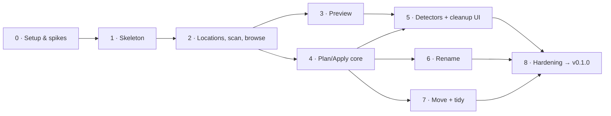

# Kipple: MVP Task Breakdown

The MVP (v0.1) broken into tasks, following the vertical slices in [ARCHITECTURE.md §13](ARCHITECTURE.md#13-mvp-build-order-vertical-slices).
Scope comes from [FUNCTIONAL_PLAN.md](FUNCTIONAL_PLAN.md), the design from [DESIGN.md](DESIGN.md), and terms from [CONTEXT.md](CONTEXT.md).
Repository: [github.com/aaronnoels2010/kipple](https://github.com/aaronnoels2010/kipple). CI, releases (GitHub Releases) and the update `latest.json` all live there.

**Sizes:** **S** ≤ 1 day · **M** 2–3 days · **L** about a week.
**Tracking:** tick the checkbox when a task meets its *Done when* criteria and the global Definition of Done below.

---

## Definition of Done (applies to every task)

- [ ] **Tests written first** (red → green → refactor) and passing in CI on **macOS, Windows and Linux**
- [ ] `cargo fmt`, `clippy` (including `disallowed-methods`), ESLint and type checks are clean
- [ ] **No user-visible text in code.** Strings live in `locales/en` + `locales/nl`, and the backend returns codes + parameters ([ADR-0004](adr/0004-i18n-codes-not-text.md))
- [ ] **No file mutation outside the Executor** ([ADR-0002](adr/0002-plan-review-apply.md))
- [ ] **No raw paths from the frontend** ([ADR-0007](adr/0007-backend-trust-boundary.md))
- [ ] UI uses design tokens only (no hex values), with keyboard access and a visible focus ring
- [ ] New source files carry `SPDX-License-Identifier: GPL-3.0-or-later`
- [ ] Docs updated where behaviour or terms changed (CONTEXT.md, ADRs, ARCHITECTURE.md)

---

## Overview

| Milestone | Outcome |
|---|---|
| **M0** | The risky assumptions (macOS permissions, Trash undo, scan speed, trash detection) are tested and the results recorded |
| **M1** | Kipple installs and starts on all three OSes from CI-built, unsigned installers |
| **M2** | You can add locations, scan, and browse/search your files |
| **M3** | Quick look and previews work safely, including on untrusted files |
| **M4** | Manual trash + undo works, with crash recovery proven by fault-injection tests |
| **M5** | Cleanup suggestions with reasons, review and trash: the core value of Kipple |
| **M6** | Batch rename with live preview and conflict handling |
| **M7** | Same-drive moves and one-click tidy presets |
| **M8** | **v0.1.0 released** |

Slices 3, 6 and 7 can run in parallel once their dependencies are done.

---

## Slice 0: Setup & spikes (→ M0)

Spikes are **throwaway** prototypes (`spikes/` folder, not shipped). Each one ends with a short write-up, and with an ADR when it changes a decision.

- [ ] **K-0.1 Repository hygiene** · S
  - **Goal:** a repo that open-source contributors can work in.
  - **Done when:**
    - `README.md` (what, status, links to docs) exists.
    - `CONTRIBUTING.md` covers the **DCO sign-off**, TDD and the Definition of Done.
    - `CODE_OF_CONDUCT.md` and `SECURITY.md` exist.
    - `.gitignore` covers `target/`, `node_modules/`, `.omc/` and `spikes/**/out`.
    - There are issue and PR templates.
    - A script checks the SPDX headers.
  - **Still open:**
    - [ ] Code of Conduct contact (`[INSERT CONTACT METHOD]` in `CODE_OF_CONDUCT.md`)
    - [ ] Enable *Private vulnerability reporting* in the GitHub repo settings (linked from `SECURITY.md`)
- [x] **K-0.2 Toolchain pinning** · S
  - **Done when:**
    - `rust-toolchain.toml`, `.nvmrc`, pnpm and `.editorconfig` are in place.
    - `docs/DEVELOPING.md` lists the prerequisites per OS (Rust, Node, Tauri system dependencies, WebView2 and WebKitGTK notes).
- [x] **K-0.3 Spike S2: unsigned macOS + whether permissions survive updates** · M ([ADR-0008](adr/0008-macos-signing-without-notarisation.md))
  - **Goal:** find out whether an app signed without notarisation keeps its macOS folder permissions (TCC grants) across updates.
  - **Done when:** on a clean Mac, the flow download → first launch → grant folder access → update to a newer build has been tested with **an ad-hoc signature vs a self-signed certificate**. The result is recorded in **ADR-0008**, and the first-launch steps for the install guide are written up.
  - **Depends on:** a minimal Tauri hello-world.
- [x] **K-0.4 Spike S1: undo after moving to the macOS Trash** · S ([result](../spikes/s1-macos-trash/README.md))
  - **Done when:**
    - A prototype using `objc2` calls `trashItemAtURL:resultingItemURL:` and records the resulting URL.
    - Restoring the file works **without Full Disk Access**.
    - The behaviour on external and network volumes is documented.
- [x] **K-0.5 Spike S4: scan performance** · M ([result](../spikes/s4-scan-perf/README.md))
  - **Done when:**
    - There is a **synthetic tree generator** (100k and 1M files, realistic depth and names).
    - The `ignore` walker plus metadata collection (including file IDs) has been benchmarked on macOS, Windows (NTFS) and Linux (ext4).
    - Results are compared with the targets (first scan of 100k files < 60 s, rescan < 5 s), with a decision on the Windows enumeration path.
- [x] **K-0.6 Spike S9: Trash support per volume** · S ([result](../spikes/s9-trash-support/README.md))
  - **Done when:** there is a matrix of internal / USB exFAT / USB NTFS / SMB / NFS × macOS / Windows / Linux showing whether a Trash exists and how to detect it. The rule is that unknown counts as "no Trash".

---

## Slice 1: Skeleton (→ M1)

- [x] **K-1.1 Cargo workspace & crate boundaries** · S (`app/src-tauri` joins the workspace in K-1.2; its layering rule is already in place as `kipple-app`)
  - **Done when:**
    - The workspace contains `kipple-core`, `-index`, `-engine`, `-platform`, `-preview`, `-i18n-rs` and `-cli`, plus `app/src-tauri`.
    - `kipple-core` has **no I/O dependencies**, checked by a CI check that inspects the dependency tree.
    - `cargo-deny` is configured for licences (GPL-3.0 compatible) and advisories.
    - A clippy `disallowed-methods` list for file-mutating APIs is in place, with an allowlist for the executor and adapter modules.
- [x] **K-1.2 Tauri 2 app shell** · M
  - **Done when:**
    - React + TS + Vite run in Tauri.
    - Single-instance is enabled, and the minimum window size is 960 × 600.
    - **Capabilities are locked down:** no `plugin-fs`, no asset-protocol scope.
    - A strict CSP and a navigation guard are in place (only the app's own origin; external links open in the browser).
  - **Refs:** ADR-0001, ADR-0007.
- [x] **K-1.3 Typed IPC** · S
  - **Done when:**
    - tauri-specta generates `app/src/bindings`.
    - One command, `app.info`, works end-to-end.
    - CI fails if the generated bindings are stale.
    - A shared `Coded { code, params }` result type exists.
- [x] **K-1.4 Design tokens & theming** · M (the visible Light/Dark/System control is added with the shell/settings UI once i18n exists; the commands, event and hook are in place)
  - **Done when:**
    - `app/src/styles/tokens.css` matches `design.html`.
    - Tailwind v4 `@theme` mapping is set up.
    - **Fraunces, Instrument Sans and Martian Mono are bundled** (WOFF2, OFL).
    - Light / dark / system switching works, with the OS appearance coming from Rust and the user override saved in `config/settings.json`.
    - The `<Hen state>` SVG component exists.
  - **Refs:** DESIGN.md §3–5, §13.
- [x] **K-1.5 i18n plumbing** · M
  - **Done when:**
    - `locales/{en,nl}` and react-intl (ICU) are wired up.
    - The OS locale comes from `sys-locale`.
    - A pseudo-locale exists.
    - A **CI check fails** on missing or unused keys.
    - The `kipple-i18n-rs` build step generates the Rust mini-catalog (tray and notification keys in `locales/<lang>/tray.json`, ICU4X plurals).
    - The `trash.name` key is platform-aware.
  - **Refs:** ADR-0004.
- [x] **K-1.6 App shell UI** · M
  - **Done when:**
    - Sidebar, top bar and routing work, with empty screens for Overview, Browse, Cleanup, Rename, Tidy, History and Settings.
    - The keyboard map and cheat-sheet (`?`) work.
    - The empty states use the hen.
    - EN and NL both render without clipped text.
  - **Refs:** DESIGN.md §7, §10, §11.
- [x] **K-1.7 Logging & redaction** · S
  - **Done when:**
    - `tracing` writes rolling log files to the app log dir.
    - A redaction layer replaces paths with an **HMAC-SHA256 hash using a per-install salt**.
    - A panic hook and an error-string scrubber are in place.
    - Unit tests prove that no raw path reaches the log file.
- [x] **K-1.8 CI pipeline** · M
  - **Done when:** `ci.yml` runs clippy, Rust tests (including the bindings and Rust catalog checks) and the frontend tests and build (including the i18n checks) on **macOS, Windows and Ubuntu**, and the OS-independent checks once: fmt, the licence checks (`cargo-deny` + npm) and the SPDX check.
- [x] **K-1.9 Release pipeline** · M
  - **Done when:** a tag triggers `tauri-action`, which builds:
    - **Windows:** an NSIS installer (`currentUser`), an MSI, and a portable exe with a `portable` marker file.
    - **macOS:** a universal `.dmg`, signed using the result of K-0.3.
    - **Linux:** AppImage, `.deb` and `.rpm`.

    It also generates SHA-256 checksums and GitHub provenance attestations, and creates a draft release. The update key is generated, stored as a CI secret and backed up offline. Producing `latest.json` is ready for v1.
  - **Depends on:** K-0.3.
- [x] **K-1.10 Install guide** · S
  - **Done when:** `docs/INSTALL.md` (EN and NL) covers first launch on each OS (Open Anyway on macOS, More info → Run anyway on Windows, chmod for the AppImage) and how to verify the checksums.
- [x] **K-1.11 Spike S8: idle memory with the webview destroyed** · S
  - **Done when:** tray-only memory has been measured with the webview destroyed vs hidden on all three OSes, ADR-0004 is confirmed or adjusted, and the tray menu runs from the Rust catalog.

- [x] **K-1.12 Portable mode** · S
  - **Done when:** with a `portable` file next to the executable (the Windows portable zip ships one), Kipple keeps its config, data, cache and logs in a `KippleData` folder beside it instead of the per-user app folders, and never offers to update itself. Found while building K-1.9: the release already ships the marker, but the app doesn't read it yet.
---

## Slice 2: Locations, scan & browse (→ M2)

- [ ] **K-2.1 Core domain types** · S
  - **Done when:** `Item`, `Location`, `TypeCategory`, facets, `VolumeCaps`, `Identity` and `ContentStamp` are defined in `kipple-core`, with extension → type classification and table-driven tests.
- [ ] **K-2.2 index.db** · M
  - **Done when:**
    - The schema matches ARCH §6.1, including **FTS5 trigram** search on names.
    - The index is rebuilt when the schema version changes.
    - Batched upserts and keyset pagination work.
    - A query benchmark shows search < 100 ms at 1M rows.
- [ ] **K-2.3 Platform ports framework** · L
  - **Done when:**
    - The traits from ARCH §8 exist with `Unsupported` handling.
    - There are **in-memory fakes**.
    - A **contract test harness** runs per OS in CI.
    - First adapters are done on all three OSes: `Volume` (ID, kind, capabilities), `ProtectedPaths` + `Bundles` (including `.git`), `Placeholder` and `SyncRoots`.
- [ ] **K-2.4 Location management** · M
  - **Done when:**
    - The default user folders can be toggled.
    - "Add folder" works **through a native dialog invoked from Rust** and returns a token.
    - The **online check by `volume_id`** works.
    - Offline locations keep their items and are never treated as deleted.
    - The sync-root flag is set.
    - Commands: `locations.*`.
- [ ] **K-2.5 Job scheduler** · M
  - **Done when:**
    - The queue has priorities (interactive > scan > enrich > hash > thumbnails).
    - Jobs support cancellation tokens and pause/resume.
    - Progress events are throttled to 10 per second or fewer.
    - Concurrency limits depend on the kind of volume.
- [ ] **K-2.6 Walker & diff** · L
  - **Done when:**
    - The parallel `ignore` walker runs with `standard_filters(false)`.
    - It respects exclusions, protected paths and opaque bundles/VCS dirs.
    - It diffs on `(size, mtime, ctime, file_id)` **per directory** (loading only `WHERE parent_path = ?`, never the whole location: S4 measured about 400 MB at 1M files otherwise), and clears hashes when an item changes.
    - **Windows:** enumerates with `FileIdBothDirectoryInfo` (falling back to std + per-file handle) and uses the path as identity on FAT/ExFAT.
    - Memory stays flat during a rescan: a test at 1M files keeps peak RSS below 150 MB.
    - Placeholders are only `stat`-ed.
    - `._*` AppleDouble companion files (created by macOS on FAT/ExFAT, spike S1) are marked as OS metadata: hidden from counts, and a folder holding only `._*` files counts as empty.
    - Commands: `scan.start | pause | resume | cancel | status`.
    - Tests use temp trees, and the K-0.5 targets are met.
- [ ] **K-2.7 Enrichers** · M
  - **Done when:**
    - Download origin is read on all three OSes.
    - The screenshot flag is set on all three OSes, including **localised names**.
    - Unknown extensions are sniffed with `infer`.
    - EXIF and dimensions are read.
    - Everything runs as low-priority batched jobs.
- [ ] **K-2.8 Last-used signals (+ spike S3)** · M
  - **Done when:**
    - The `LastUsed` adapters work: batched Spotlight on macOS, Recent `.lnk` on Windows, `recently-used.xbel` and KDE on Linux.
    - `last_used_at` and `last_used_source` are filled.
    - Benchmark results on 100k files are recorded, with a fallback when a signal is too slow.
- [ ] **K-2.9 Browse UI** · M
  - **Done when:**
    - Virtualised list and grid views work, with sort, filters (type, size, date, status) and search (`items.search`).
    - The sidebar shows locations with online/offline dots.
    - Scan progress is shown.
    - A 1M-row index scrolls smoothly.
- [ ] **K-2.10 Open & reveal** · S
  - **Done when:**
    - `items.open` asks for confirmation for executables, installers and scripts, and records an "opened in Kipple" last-used signal.
    - `items.reveal` works on all three OSes.
- [ ] **K-2.11 CLI harness** · S
  - **Done when:** `kipple-cli scan <dir>`, `kipple-cli bench` and `kipple-cli gen-tree` work and are used by the integration tests.

---

## Slice 3: Preview (→ M3)

- [ ] **K-3.1 `kipple-preview://` scheme** · M
  - **Done when:**
    - Short-lived tokens are issued per item (`preview.open`).
    - The handler refuses placeholders, protected and excluded paths, and offline locations.
    - Responses carry an explicit MIME type and `nosniff`, and **support Range requests**.
    - Security tests cover path traversal and placeholder hydration.
  - **Refs:** ADR-0007.
- [ ] **K-3.2 Thumbnails** · M
  - **Done when:**
    - The provider chain works: OS-native (QuickLookThumbnailing, `IShellItemImageFactory`, freedesktop) → `image` crate → icon.
    - An LRU disk cache with a size cap is keyed by `(path hash, size, mtime)`.
    - HEIC works where the OS supports it.
- [ ] **K-3.3 Preview renderers** · M
  - **Done when:**
    - Image, PDF (pdf.js **pinned ≥ 4.2.67**, eval disabled), video/audio, text/code (CodeMirror read-only, first N KB), CSV table and Markdown (no raw HTML) render.
    - SVG is shown only via ``, and HTML files as text.
    - There is an "open in default app" fallback.
- [ ] **K-3.4 Quick look & metadata panel** · M
  - **Done when:**
    - `Space` toggles the preview, with arrow keys moving between items.
    - The metadata panel shows size, dates, location, origin, last used (with its source), EXIF, duration and page count, cached back into `meta_json`.
    - There are placeholder and offline states.
- [ ] **K-3.5 Spike S5: WebKitGTK codecs** · S
  - **Done when:** H.264, HEVC and VP9 playback is tested on Ubuntu and Fedora, and the fallback UX is confirmed.

---

## Slice 4: Plan/Apply core (→ M4)

The safety foundation. **This slice gets the most thorough tests.**

- [ ] **K-4.1 Plan, Operation & Issue types** · S
  - **Done when:** the core types from CONTEXT.md exist (Move, Rename, Trash, CreateDir, RemoveEmptyDir; all Issue kinds) with serde and specta, and plans are pure data.
- [ ] **K-4.2 Validator** · L
  - **Done when:** pure functions plus platform facts check:
    - locations and destination tokens, and protected paths,
    - collisions on the file system and within the plan,
    - **name validity per OS** (reserved names, trailing dots and spaces, length, illegal characters, NFC/NFD),
    - **case-only renames** (two steps),
    - **`NoTrashOnVolume`** (blocking), `CrossVolumeNotSupported`, placeholders and the sync-root notice.

    Covered by property tests.
- [ ] **K-4.3 state.db** · M
  - **Done when:** the schema matches ARCH §6.2, **`synchronous=FULL`** is set, migrations are forward-only, and an **automatic backup before migrating** is in place and tested.
- [ ] **K-4.4 Plan store & commands** · M
  - **Done when:**
    - `plans.get | discard | apply(plan_id, resolutions, consent?)` work.
    - **Plans are re-validated at apply time.**
    - Plans expire.
    - The frontend can only refer to item IDs and tokens.
- [ ] **K-4.5 Executor** · L
  - **Done when:**
    - Batches are **write-ahead**: all entries are pending before the first operation.
    - Operations and sub-steps run with per-entry status, and status updates are group-committed.
    - Error codes are classified (ARCH §7.2).
    - The apply policy (limits, `allow_permanent_delete`) is enforced.
    - Progress events are emitted.
- [ ] **K-4.6 Trash port with restore** · M
  - **Done when:**
    - `supports(volume)` works on all three OSes, using the rules proven in K-0.6 (ARCHITECTURE §8). A contract test asserts that **trash is never called on a Windows network drive or UNC path**, where S9 showed the call silently deletes permanently.
    - Trash and restore work on Windows and Linux via the `trash` crate, and on macOS via NSFileManager (from the K-0.4 spike).
    - Restores use the no-overwrite primitives from ADR-0002 §9, including the ExFAT fallback, and are tested on APFS, Mac OS Extended, ExFAT and FAT32 images in CI.
    - An entry is marked done only after its trash location has been recorded.
    - `TrashUsage` works.
- [ ] **K-4.7 Recovery** · L
  - **Done when:**
    - On startup, Kipple **reconciles interrupted batches by identity** (dst / src / trash / unknown).
    - `recovery.resume | rollback` work.
    - A **fault-injection suite** covers a crash at every operation and sub-step, plus simulated power loss (uncommitted state dropped).
    - No scenario loses a file or guesses an outcome.
- [ ] **K-4.8 Undo** · M
  - **Done when:**
    - `journal.undo` builds inverse plans for whole batches or single entries.
    - It checks **identity**: it skips the entry on a mismatch and warns when only the content changed.
    - Undoing a Trash restores the file.
    - Tests cover undo after the user modified, moved or deleted the file.
- [ ] **K-4.9 Replace, retry & skipped report** · S
  - **Done when:** Replace in a conflict becomes a journaled `Trash(existing)`, `plans.retry(batch_id)` works for skipped entries, and skipped entries are grouped by reason code.
- [ ] **K-4.10 History & feedback UI** · M
  - **Done when:**
    - The History timeline (grouped by day, filterable by source) has Undo per batch and per entry.
    - The toast has **Undo**.
    - The recovery banner works.
    - The skipped-files banner has Show files and Retry.
    - Manual "Move to Trash" works from Browse via the dry-run dialog.
    - The **no-Trash consent dialog** requires typing `delete N`.

---

## Slice 5: Detectors & cleanup UI (→ M5)

- [ ] **K-5.1 Detector framework** · M
  - **Done when:**
    - Detectors **stream** over SQL-backed iterators and never load the whole index.
    - Candidates are stored with a reason code, parameters, confidence and reclaimable bytes.
    - Marks are applied as a filter, and detectors re-run when the index changes.
- [ ] **K-5.2 Duplicates** · M
  - **Done when:**
    - Duplicates are found via size groups → quick hash (first + last 64 KiB) → full BLAKE3 hash, run as hash jobs.
    - Duplicate groups get a suggested copy to keep, with selectable rules (oldest, shortest path, in Documents).
    - Files are **re-hashed at apply time**.
- [ ] **K-5.3 Old installers + `InstalledApps` port** · M
  - **Done when:** the `InstalledApps` adapters work on all three OSes, and the `installer_old` detector uses both "app appears installed" and "installer for another OS".
- [ ] **K-5.4 Other MVP detectors** · M
  - **Done when:** `archive_extracted`, `download_incomplete` (age + no longer changing), `empty_file` / `empty_dir` (**never mountpoints, location roots or offline locations**), `large_old` and `screenshot_old` all work with configurable thresholds.
- [ ] **K-5.5 Marks** · S
  - **Done when:** pinned and never-suggest marks (file, folder, detector) are stored by identity, survive moves, and `marks.set | clear` work.
- [ ] **K-5.6 Overview screen** · M
  - **Done when:** the kipple meter, detector cards, the space-saved card with sparkline, the Trash reminder, recent History and the recovery banner match `design.html`.
- [ ] **K-5.7 Cleanup screen** · L
  - **Done when:**
    - Detector chips, the candidate list (reason + confidence eggs + size), the preview pane (reason box, metadata, Never suggest) and the action bar work.
    - The **dry-run dialog** shows a per-detector summary.
    - The **Trash reminder** appears after applying.
    - Placeholder rows are disabled.
- [ ] **K-5.8 Duplicate resolver UI** · M
  - **Done when:** copies are shown side by side with a Keep marker, the keep rule can be selected, and bulk resolve works across groups.
- [ ] **K-5.9 Stats** · S
  - **Done when:** `stat_daily` is written by the executor, and the "space saved" and "files tidied" counters work.

---

## Slice 6: Rename (→ M6)

- [ ] **K-6.1 Rename engine** · M
  - **Done when:**
    - These steps work: replace (plain/regex), prefix/suffix, sequence, case, date tokens (`{created}`, `{modified}`, `{exif.date}`), trim, normalise and change extension.
    - The engine is a pure function.
    - **Property tests** cover no collisions after validation, stability, and extensions being preserved.
- [ ] **K-6.2 Preview & plan** · S
  - **Done when:** `rename.preview` is debounced and returns new names plus issues, and `plans.rename` creates the plan.
- [ ] **K-6.3 Rename UI** · M
  - **Done when:**
    - The step pipeline supports drag to reorder.
    - The live before → after table highlights the changed part.
    - **Conflict and invalid-name rows** are marked.
    - The action bar reads "Rename N, skip M".
- [ ] **K-6.4 Presets** · S
  - **Done when:** `config/rename-presets.json` has a versioned schema, presets can be saved and loaded, and "Holiday photos" ships as a built-in example.
- [ ] **K-6.5 Single inline rename** · S
  - **Done when:** `F2` / `Enter` renames inline, with the extension protected and live OS validation.

---

## Slice 7: Move & tidy (→ M7)

- [ ] **K-7.1 Same-drive moves** · M
  - **Done when:**
    - `plans.move(item_ids, dest_ref)` works within a volume, and moves to another drive are refused with a clear message.
    - Drag & drop and cut/paste work in Browse.
    - The destination dialog returns tokens.
    - Moves can be undone.
- [ ] **K-7.2 Tidy planners** · M
  - **Done when:** the "Sort Desktop by type", "Archive Downloads by year/month" and "Photos by date taken" presets produce plans.
- [ ] **K-7.3 Tidy UI** · M
  - **Done when:** preset cards, a **folder-tree preview** of the result, and dry run + apply work.

---

## Slice 8: Hardening & release (→ M8 · v0.1.0)

- [ ] **K-8.1 Onboarding** · M
  - **Done when:** the four steps work (welcome → pick locations, including the sync-root notice → permissions guide per OS → first scan → quick wins), and it is skippable and resumable.
- [ ] **K-8.2 Settings** · M
  - **Done when:**
    - Language, theme, launch at login, thresholds and locations can be set.
    - The **update check toggle** is there (off-path for MVP; v1 wires the updater, which must stay off in portable mode: `portable::is_portable`).
    - Config export/import works, and imported rules are disabled.
    - **Remove all Kipple data** works.
- [ ] **K-8.3 Diagnostics export** · S
  - **Done when:** a `.zip` contains the logs, version, OS and **redacted settings**, with an opt-in to include paths, and a test proves redaction.
- [ ] **K-8.4 Performance & memory pass** · M
  - **Done when:** every target in FUNCTIONAL_PLAN §0 is measured on all three OSes (100k / 1M files, search, preview, idle memory), with regressions tracked by a nightly benchmark.
- [ ] **K-8.5 Accessibility pass** · M
  - **Done when:** keyboard-only walkthroughs of all MVP flows work, screen-reader labels are in place (VoiceOver, NVDA, Orca smoke tests), axe checks run in Playwright, and contrast is re-verified.
- [ ] **K-8.6 Dutch translation complete** · S
  - **Done when:** all keys are translated and **reviewed by a native speaker** (Flemish and Dutch wording checked), and the pseudo-locale pass shows no clipping.
- [ ] **K-8.7 E2E suite** · M
  - **Done when:**
    - Playwright (with an IPC mock) covers scan → review → trash → undo, batch rename with a conflict, tidy, and recovery.
    - `tauri-driver` smoke tests run on Windows and Linux.
- [ ] **K-8.8 Release v0.1.0** · S
  - **Done when:** the README has screenshots (both themes), the privacy statement is shipped, the install guide is linked, the changelog is written, the checksums and attestations are verified, and **installs have been tested by hand on a clean machine for each OS**.

---

## After the MVP (v1 backlog, not broken down yet)

Rules engine + recommended rules + review inbox · watch mode · similar images · versions check · holding area · cross-drive moves (copy → verify → trash) · storage treemap · tray + schedules + notifications · tags · quick triage · archive previews, extract & compress · right-click menu integration (spike S7) · network drives / NAS · hidden-files toggle · smart folders · built-in help · "What's new" · **auto-update** · high-contrast theme.
